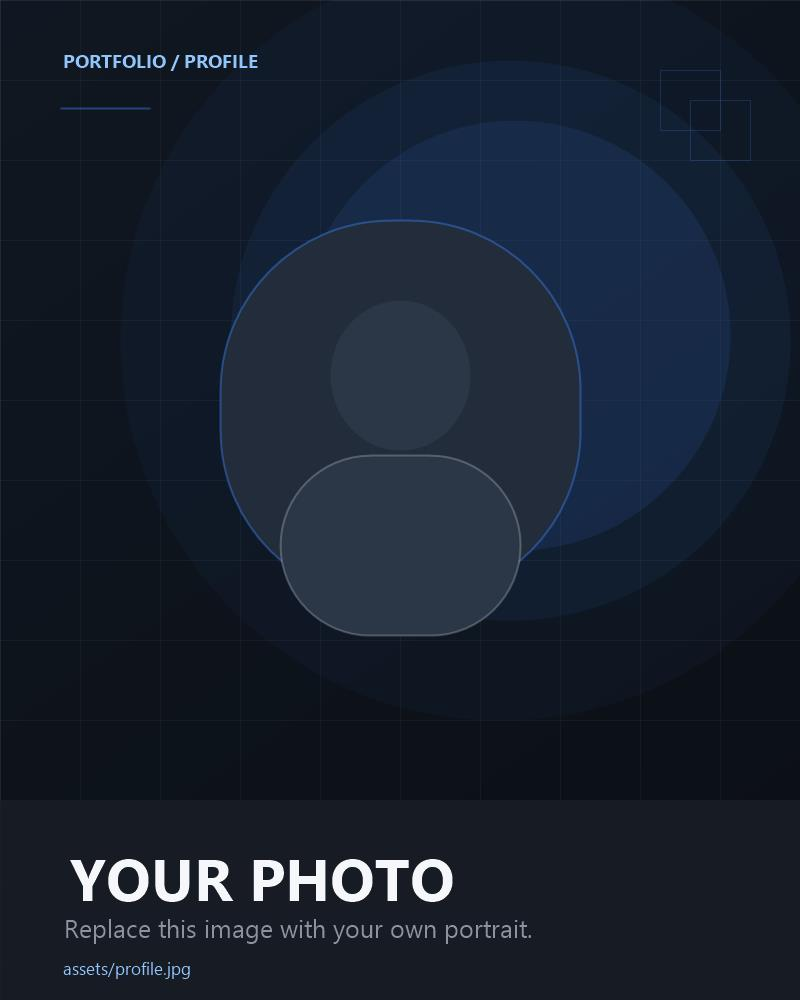

# Leny Khoirina — Personal Portfolio

A clean, responsive personal portfolio built with **HTML5 and CSS3 only**.
There is no JavaScript, no framework, and no build tool.

## Folder Structure

```text
portfolio/
├── index.html
├── css/
│   └── style.css
├── assets/
│   ├── favicon.svg
│   ├── images/
│   │   ├── profile.jpg
│   │   ├── project-1.jpg
│   │   ├── project-2.jpg
│   │   └── project-3.jpg
│   └── certificates/
│       ├── certificate-1.pdf   (add your own)
│       ├── certificate-2.pdf   (add your own)
│       └── certificate-3.pdf   (add your own)
└── README.md
```

---

## 1. How to Open the Website

1. Open the `portfolio` folder.
2. Double-click `index.html`.
3. The website will open in your default browser.

No installation, server, or build step is needed.

If you want to preview it like a real website, you can also use a simple local
server (for example, the **Live Server** extension in Visual Studio Code), but
this is optional.

---

## 2. Where to Put the Profile Photo

Replace this file:

```text
assets/images/profile.jpg
```

Keep the same filename (`profile.jpg`) so the website finds it automatically.
A portrait photo works best. The recommended size is around **800 × 1000 pixels**.

In `index.html`, the photo is inside the hero section:

```html
<!-- Replace profile.jpg with your own profile photo -->

```

You can also update the `alt` text to describe your new photo.

---

## 3. Where to Put Project Images

Replace these files with your own project screenshots or previews:

```text
assets/images/project-1.jpg
assets/images/project-2.jpg
assets/images/project-3.jpg
```

Keep the same filenames. A wide image (around **1200 × 750 pixels**) looks best.

---

## 4. Where to Put PDF Certificates

Put your certificate PDF files in:

```text
assets/certificates/
```

Use these exact filenames so the existing links work:

```text
certificate-1.pdf
certificate-2.pdf
certificate-3.pdf
```

The **View Certificate** buttons already open the PDFs in a new browser tab.
Do not convert the PDFs into images.

---

## 5. Placeholders to Replace

Search `index.html` for text inside square brackets, such as:

- `[PROJECT NAME 1]`
- `[ADD PROJECT DESCRIPTION HERE]`
- `[ADD TECHNOLOGIES HERE]`
- `[YEAR]`
- `[STATUS]`
- `[PROJECT LINK]`
- `[GITHUB LINK]`
- `[EXPERIENCE / ORGANIZATION NAME]`
- `[YOUR ROLE]`
- `[ADD YOUR EXPERIENCE DESCRIPTION HERE]`
- `[CERTIFICATE NAME]`
- `[ISSUER / ORGANIZATION]`
- `[ACHIEVEMENT NAME]`
- `[SHORT DESCRIPTION]`
- `[LANGUAGE]`
- `[LEVEL]`
- `[YOUR EMAIL HERE]`
- `[YOUR GITHUB LINK]`
- `[YOUR LINKEDIN LINK]`
- `[YOUR INSTAGRAM LINK]`
- `[YOUR OTHER SOCIAL LINK]`

Replace them with your real information. Do not leave placeholders in the final
published version unless you deliberately want to add the information later.

---

## 6. How to Add More Projects

1. Open `index.html`.
2. Find the `<!-- ===== PROJECTS ===== -->` section.
3. Copy one complete `<article class="project-card"> ... </article>` block.
4. Paste it after the last project card, inside `<div class="projects-grid">`.
5. Change the title, description, technologies, year, status, links, and image.
6. Add a matching image file in `assets/images/` (for example,
   `project-4.jpg`).

The grid will arrange the new card automatically.

---

## 7. How to Add More Certificates

1. Open `index.html`.
2. Find the `<!-- ===== CERTIFICATES ===== -->` section.
3. Copy one complete `<article class="cert-card"> ... </article>` block.
4. Paste it after the last certificate card, inside `<div class="cert-grid">`.
5. Change the certificate name, issuer, year, and PDF filename.
6. Put the new PDF file in `assets/certificates/`.

Example link:

```html
<a class="btn-cert" href="assets/certificates/certificate-4.pdf" target="_blank" rel="noopener">View Certificate</a>
```

The new card will follow the same design automatically.

---

## 8. How to Change Social Media Links

1. Open `index.html`.
2. Find the `<!-- ===== CONTACT ===== -->` section.
3. Look for links like this:

```html
<a class="social-link" href="#">
    <span>GitHub</span>
    <span class="social-value">[YOUR GITHUB LINK]</span>
</a>
```

4. Replace `href="#"` with your real profile URL (for example,
   `https://github.com/yourusername`).
5. Replace the placeholder text `[YOUR GITHUB LINK]` with the same URL or with
   your username.

Do the same for LinkedIn, Instagram, and any other social link.
Do not use fake URLs.

---

## 9. How to Change the Email

1. Open `index.html`.
2. Find the Email block in the contact section:

```html
<p class="placeholder-value">[YOUR EMAIL HERE]</p>
```

3. Replace `[YOUR EMAIL HERE]` with your real email address.

If you want the email to be clickable, replace the paragraph with a link:

```html
<a class="placeholder-value" href="mailto:youremail@example.com">youremail@example.com</a>
```

---

## 10. How to Change the Colors

All colors are stored at the top of `css/style.css` in the `:root` block:

```css
:root {
    --primary-blue: #8FAFC7;
    --soft-blue: #BFD4E3;
    --light-blue: #EAF3F8;
    --white: #FFFFFF;
    --dark-blue: #304B5F;
    --text: #263746;
    --muted-text: #6F8291;
}
```

Change the hex values to create a different color theme. Because the rest of
the stylesheet uses these variables, most of the website will update
automatically.

Useful notes:

- `--primary-blue` is used for small accents and decorative details.
- `--soft-blue` is used for borders and soft highlights.
- `--light-blue` is used for section backgrounds and pills.
- `--dark-blue` is used for buttons, headings, and strong accents.
- `--text` is the main body heading color.
- `--muted-text` is the original muted tone; the supporting `--muted-strong`
  value is used for small text so it stays readable.

---

## Extra Tips

- Keep image files reasonably small so the page loads quickly.
- Use descriptive `alt` text for every image.
- Check the website on a phone or in your browser's responsive mode.
- The contact form is a visual demo only. It does not send emails. Connect it to
  a backend or email service later if needed.
- All animations are created with CSS only. The site respects the
  `prefers-reduced-motion` setting for visitors who prefer less motion.
